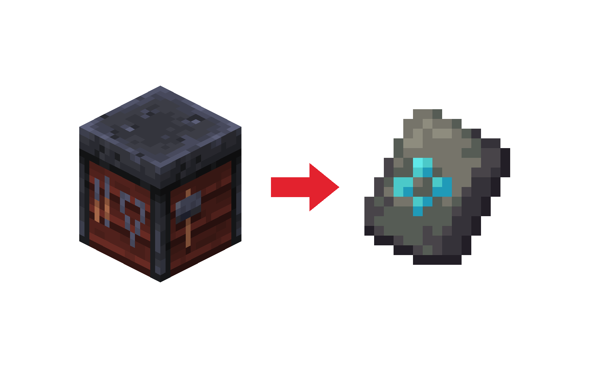

# jei盔甲纹饰配方分离 · JEI Armor Trim Tab

把盔甲纹饰移出 JEI 的锻造台分类，放进紧邻的独立标签。下界合金升级等非纹饰配方留在锻造台标签。本模组仅改变客户端显示，不修改配方。

## 安装

在 [Releases](../../releases) 选择与实例匹配的 JAR，和 JEI 一起放进客户端的 `mods`· 目录。服务端无需安装。

| Minecraft | 加载器 | JEI | 发行 / 源码 |
| --- | --- | --- | --- |
| 1.20.1 | Forge 47.x | 15.20.0.106 至 15.x | [发行](../../releases/tag/v1.1.0-forge-1.20.1) · [源码](forge-1.20.1/) |
| 1.21.1 | NeoForge 21.1.x | 19.38.0.366 至 19.x | [发行](../../releases/tag/v1.1.0) · [源码](neoforge-1.21.1/) |、
| 1.20.1/1.21.1 | Fabric | 15.20.0.106 至 15.x | [Fabric 发行](../../releases/tag/v1.1.0-fabric-1.20.1) |

Fabric 版还需要安装对应游戏版本的 Fabric API。

在 JEI 物品列表中悬停锻造台并按 **U**（默认“查看用途”键）即可查看两个标签。

## 构建

在对应源码目录，使用表中指定的 JDK 与 Gradle 8.13 执行 `gradle build`。构建产物见该工程的 `build/libs`。

## 许可证与素材

模组源码使用 [MIT License](LICENSE)。封面使用 Minecraft 原版锻造台与哨兵盔甲纹饰模板贴图；Minecraft 素材权利归 Mojang Studios / Microsoft 所有，不在 MIT 授权范围内。此项目与 Mojang Studios / Microsoft 无关。
